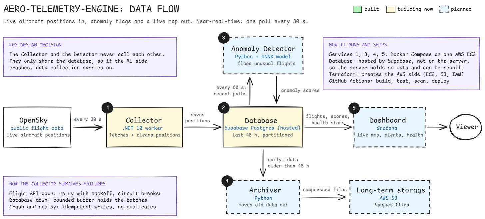

# Aero Telemetry Engine

A fault-tolerant pipeline that ingests live aircraft positions from the OpenSky Network every 30 seconds, stores them in PostgreSQL, and flags unusual flights. It is designed to keep collecting data when parts of the system fail.

**Status: in progress.** The design is complete and the ingestion layer is being built now. [What works today](#what-works-today) lists exactly what exists; the rest of this page describes the design.

**Stack so far:** C# / .NET 10 · PostgreSQL 17 (`pg_partman`, `pg_cron`) · Docker · DbUp<br>
**Planned:** Python (ONNX Runtime) · Grafana · Terraform · AWS (EC2, S3) · GitHub Actions

<picture>
  <source media="(prefers-color-scheme: dark)" srcset="docs/diagrams/architecture-dark.png">
  
</picture>

Solid boxes are being built now; dashed boxes are planned. The editable source is [docs/diagrams/architecture.excalidraw](docs/diagrams/architecture.excalidraw), and the model-training and deployment diagrams are in [docs/architecture.md](docs/architecture.md).

## What works today

| Part | State |
|---|---|
| Database schema | **Built.** Six versioned SQL migrations in [db/migrations](db/migrations), applied by a one-shot DbUp migrator. Checked on a clean Postgres 17: a second run changes nothing, and replaying a batch adds no duplicate rows. |
| Collector | **In progress.** Authenticates with OpenSky (OAuth2), fetches one poll for the configured region and logs the aircraft count. The polling loop, retries, buffer and database writer come next. |
| Time partitioning | **Built.** Daily partitions managed by `pg_partman`, with an hourly `pg_cron` job that creates new ones and detaches those older than 48 hours. |
| Anomaly detector, archiver, dashboard | Planned |
| AWS deployment (Terraform, GitHub Actions) | Planned |

## Run it

You need Docker, the .NET 10 SDK and a free [OpenSky](https://opensky-network.org) API client. No AWS account is needed.

```bash
cp .env.example .env    # then fill in OPENSKY_CLIENT_ID and OPENSKY_CLIENT_SECRET
docker compose up -d    # builds and starts local Postgres on port 5433
dotnet run --project src/Ingestion/Ingestion.Migrations    # creates the schema
dotnet run --project src/Ingestion/Ingestion.Worker        # one poll; Ctrl+C to stop
```

Today the last command ends with a log line such as `Fetched 319 aircraft in bounding box (25.0 sq deg)`. Once the dashboard is built, a single `docker compose up` will bring up the whole pipeline with a live map in Grafana.

<!-- A screenshot or short GIF of the Grafana dashboard goes here once it exists. -->

## How it works

Every 30 seconds the collector pulls the current state of all aircraft in one 5° × 5° region from OpenSky, cleans the records and writes them to PostgreSQL. A separate detector service reads recent flight paths every 60 seconds and scores them for anomalies. A Grafana dashboard reads both. Data older than 48 hours is archived to S3 as Parquet.

## Measured so far

- **319 aircraft** in one poll of the region (north-west Europe, 18 September 2026).
- **1 OpenSky credit per call**, so 2,880 polls a day fit inside the 4,000-credit daily budget.

Throughput, write latency and recovery times will be added here once the pipeline has run end to end.

## Design decisions

Only the idempotent write path and the partitioning exist in code so far. The others are the design the collector is being built to.

**The collector and the detector never call each other.** They communicate only through the database. If the Python detector crashes or falls behind, data collection is unaffected: the pipeline degrades instead of stopping. The cost is that anomaly scores lag the raw data by up to 60 seconds, which is acceptable here.

**Writes are idempotent.** Every position has the primary key `(icao24, observed_at)`. Each batch is copied into a staging table and then inserted with `ON CONFLICT DO NOTHING`, so a crash mid-batch followed by a replay produces the same table state. This is what makes at-least-once delivery safe.

**The collector buffers through database outages.** When PostgreSQL is unreachable, batches wait in a bounded in-memory buffer. The buffer is bounded on purpose: unbounded growth turns a database outage into a crash. If it fills, the oldest batch is dropped and counted, so the loss is visible.

**Plain PostgreSQL partitioning rather than a time-series extension.** TimescaleDB is deprecated on Supabase Postgres 17, and daily partitions managed by `pg_partman` cover what this project needs: fast time-range queries and cheap removal of data older than 48 hours.

**Retry with backoff plus a circuit breaker on the OpenSky API.** The API is public and rate-limited, so hammering it during an outage makes things worse. On a rate-limit response the collector waits for the time the API asks for.

## Project layout

```
src/Ingestion/Ingestion.Worker       the collector (.NET worker service)
src/Ingestion/Ingestion.Migrations   one-shot schema migrator (DbUp)
db/migrations                        versioned SQL migrations
db/postgres                          local Postgres image with pg_partman and pg_cron
docs/PRD.md                          spec, roadmap and decision log
docs/architecture.md                 diagrams, walkthrough and glossary
docs/adr                             architecture decision records
docs/diagrams                        architecture diagram and its sources
```

`services/`, `training/`, `infra/` and `grafana/` are placeholders for the planned parts.

---

Flight data comes from [The OpenSky Network](https://opensky-network.org).
