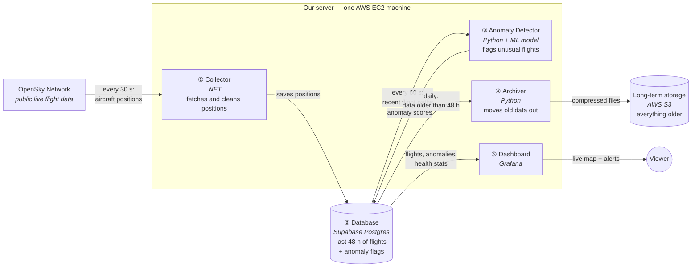
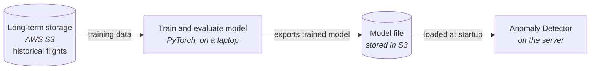
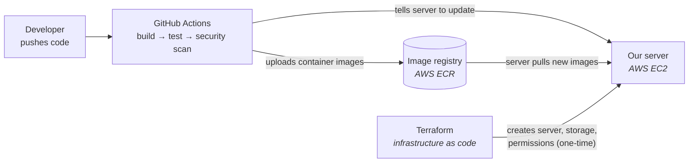

# Architecture

The architecture is three separate pictures, because they happen on different timelines:

| Diagram | When it happens |
|---|---|
| **A. How data flows** (the main one) | Continuously, while the system runs |
| **B. How the model is made** | Occasionally, offline on a laptop |
| **C. How code gets to the server** | On every push to `main` |

## A. How data flows

Arrows show which way the data moves. The technology is in *italics* under each box.

**In plain words:**

1. Every 30 seconds the **Collector** asks OpenSky where every aircraft in our region is. It throws out bad records and saves the rest.
2. The **Database** keeps only the last 48 hours, so it stays small and fast.
3. Every 60 seconds the **Anomaly Detector** reads each aircraft's recent path, scores how unusual it looks, and writes the score back.
4. Once a day the **Archiver** copies data older than 48 hours to cheap S3 storage, checks the copy is complete, and then deletes it from the database.
5. The **Dashboard** is what the viewer sees: a live map of aircraft, a list of flagged flights, and panels showing whether the pipeline is healthy.

**The key design decision:** the Collector and the Detector never talk to each other directly. They only share the database. If the ML side crashes, data collection carries on, and scoring catches up when the Detector comes back.

## B. How the model is made (offline, occasionally)

Training never runs on the server. The server only loads the finished model file.

## C. How code gets to the server (on every push)

## Glossary

- **State vector:** one snapshot of an aircraft's position, altitude, speed, heading, etc. at a moment in time.
- **icao24:** unique 24-bit transponder address of an aircraft.
- **Squawk:** 4-digit transponder code; 7500/7600/7700 indicate hijack/radio failure/emergency.
- **Partition:** a physical sub-table holding a time range of data; dropping a partition is instant compared to deleting rows.
- **BRIN index:** a very small index type suited to naturally time-ordered data.
- **Circuit breaker:** stops calling a failing service for a period, then tests it again.
- **ADR:** Architecture Decision Record — a short document explaining one design decision.
- **ONNX:** a portable model format that can run without PyTorch installed.
